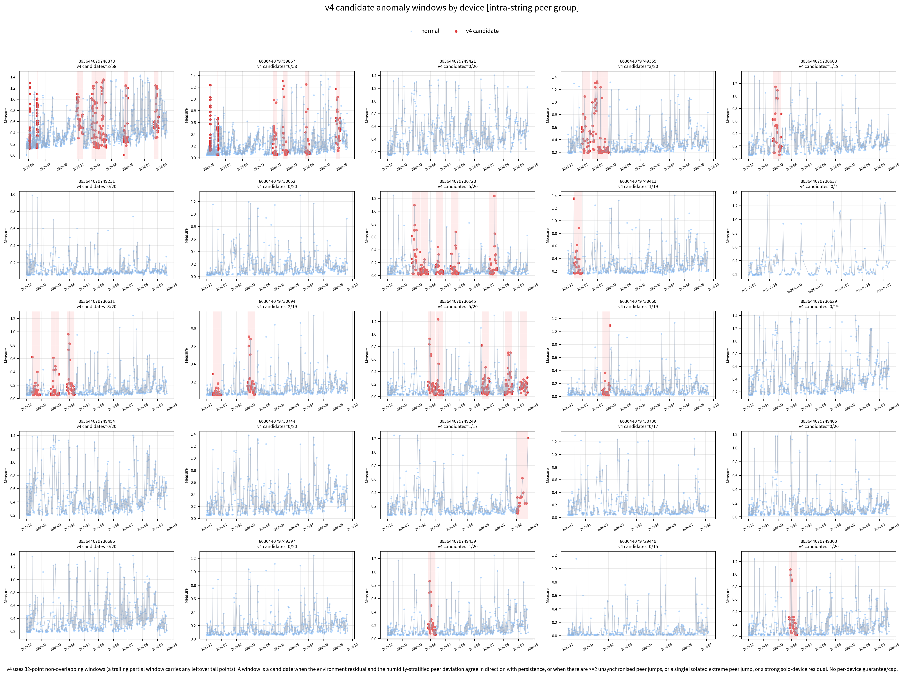
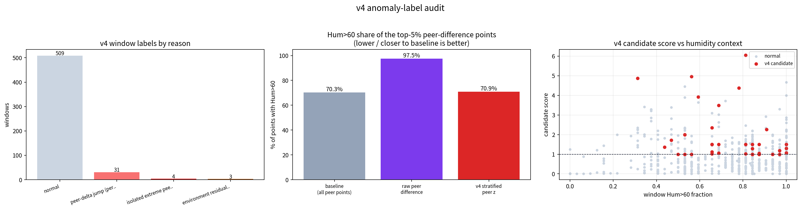

# v4 设备数据集异常窗口判定方法报告

- 数据源：`device_data_110_220_final.xlsx`（25 个设备，16,985 个有效点）
- 生成脚本：`process_device_nonoverlap_windows_v4.py`
- 结果目录：`runs/device_data_110_220_nonoverlap_windows_v4_20260928/`
- 版本定位：v4 = v3 的判定原则与规则**不变**，只把无重叠窗口从 64 点缩小到 **32 点**，用于检验更细的局部窗口能否捕捉到 64 点窗口会稀释掉的短事件。图与文件名全部带 `v4` 后缀，不覆盖 v3 最终结果。

---

## 一、为什么要做条件化（v1 的两个系统性混淆）

v1 用「固定点数窗口 + 原始 peer 残差」直接判异常，实测被两个数据特征带偏：

1. **采样间隔随时间变大**：110kV 设备早期中位间隔约 30 分钟、后期约 12 小时（约 24 倍）；220kV 设备约 4 小时→12 小时（约 3 倍）。因此「64 个点」在早期约代表 1～2 天、在后期约代表 32 天，窗口之间时间尺度不可比。
2. **`Measure` 与湿度强相关**：全设备 `corr(Measure, Hum)=0.497`，`Hum<=60` 时 `Measure` 均值约 0.112，`Hum>60` 时约 0.302，P95 从 0.276 升到 0.859。高湿抬升是**正常物理现象**，不是异常；直接用「`Measure` 高」或「原始 peer 差大」判异常会大面积误标高湿时段——实测点级 `|peer 差|` 最大的 5% 点有 **97.5%** 落在 `Hum>60`，而基准只有约 70%。

v4 的总原则：**先把时间和湿度条件化，只把「无法被时间、温度、湿度、peer 共同解释」的偏离判为异常。**

---

## 二、v4 判定流程（六步）

### 第 1 步：时间归一化与窗口切分

- 保留 **32 点无重叠窗口**，便于与 64 点的 v3 逐窗口对照；
- 每个窗口记录真实时长与采样质量：`duration_hours`、`n_points`、`median_interval_hours`；
- 所有速率类特征（斜率）除以**窗口真实时长**（`measure_slope_per_hour`），避免「点多=波动大」的假象；
- 末尾不足一个整窗的残余点**不再丢弃**：残余点数 `>= 2` 时补一个 `tail` 部分窗口，做到逐点覆盖、0 丢点。

### 第 2 步：设备级环境基线

对每台设备拟合约简稳健回归：

```
Measure ~ Huber(Temp, Hum, elapsed_days)      epsilon=1.5, alpha=1e-4
```

得到环境残差 `env_residual = Measure - pred`。该残差已去掉湿度/温度/时间引起的整体抬升。

### 第 3 步：湿度分层稳健标准化（环境残差）

- 先对残差做设备级稳健标准化（减中位数、除 1.4826·MAD）：`env_residual_z_device`；
- 再按**湿度分箱**（`HUM_BINS = [0,30,40,50,55,60,65,70,75,80,90,100,101)`）做**正态分位标准化**（箱内 rank→标准正态分位），得到 `env_residual_z`。

为什么用分位（rank→normal）而不是「减中位数/除 MAD」：单次中位数/MAD 只统一尺度、不统一尾部形状，极端值仍会堆在尾部更重的高湿箱里；分位标准化同时去掉位置、尺度和尾部形状对湿度的依赖，这是湿度混淆审计能回到基准的关键。

### 第 4 步：湿度分层的 peer 比较

- peer 口径默认 `intra-string`：**同一串（保留串号、去掉片位后缀）上的多台设备互为 peer**，共 9 个 group（7 个 3 台 + 2 个 2 台），25 台设备全部有 peer；
- peer 匹配用**最近时间点**，容差按该设备局部中位采样间隔自适应（`0.5 × median_interval`，裁剪到 30 分钟～12 小时）；
- 多台 peer 时取**逐时间点中位数**作为参考，得到 `peer_delta = residual_A − peer_residual_median`；
- 再在 **(group × 湿度箱)** 内做正态分位标准化，得到 `peer_delta_z`，使 peer 排序不再依赖湿度；
- 记录 `peer_complete`：只有当该样本点上**整个 peer 面板都被匹配到**时，其 peer 差跳变才可信，否则「匹配到哪几台发生了变化」本身会被误当成跳变。

### 第 5 步：不同步跳变（unsynchronised jump）

- 跳变用**逐设备一阶差分**（`np.diff` 沿时间、按设备分组），只保留两端 `peer_complete` 都成立的点；
- 除以 `sqrt(2)` 归一到「单位噪声「共同尺度，得到 `peer_jump_magnitude`；
- 再除以**该设备自身 peer_delta 的稳健尺度**（median/MAD），得到 `peer_delta_jump_z`。用「水平量的尺度」而不是「差分的尺度」作分母，是因为差分高度零膨胀，池化后会让人为极小的波动看起来极端。

### 第 6 步：窗口判定规则

一个窗口只要满足以下**任一**条件即为候选异常（`window_anomaly_v4 = 1`）：

| 规则 | 触发条件 | `anomaly_reason` |
|---|---|---|
| A 环境残差与 peer 同向一致且持续 | `residual_z_mean_z >= 3.0` 且 `abs2_residual_fraction >= 0.15` 且 `peer_z_mean_z >= 3.0` 且两者同号 | `environment residual and peer agree` |
| B peer 不同步跳变（窗口级） | 窗口内 `peer_delta_jump_z >= 8` 的点数 `>= 2` | `peer-delta jump (per-device)` |
| C 孤立极端跳变 | 单点 `peer_delta_jump_z >= 12` 单独成候选（末端单点尖峰永远凑不满规则 B） | `isolated extreme peer jump` |
| D 无 peer 设备的强残差 | `has_peer==0` 且 `abs2_residual_fraction>=0.15` 且 `residual_z_abs_q90>=2.0` 且 `n_large_residual_jumps>=2` | `no-peer strong residual (solo device)` |

其中窗口级证据（`residual_z_mean_z`、`peer_z_mean_z`）在**全数据集窗口池**上做稳健 z 计分，因此候选的含义是「相对全体数据不寻常」，而不是「相对本设备不寻常」——v1 的「每设备保底一个异常窗口 / 最多标一半」的人为规则被**取消**，改为输出 `candidate_score` / `candidate_rank` 置信度排序。

### 阈值汇总

| 参数 | 取值 |
|---|---|
| 窗口级证据稳健 z 阈值 | 3.0 |
| 持续性（`|env_residual_z|>=2` 点占比） | 0.15 |
| 窗口级每窗口大跳数下限 | 2 |
| 点级残差跳变 z | 2.5 |
| 点级 peer 跳变 z | 8.0 |
| 点级孤立极端 peer 跳变 z | 12.0 |
| tail 窗口最小点数 | 2 |

---

## 三、结果（25 设备 / 547 窗口）

| 指标 | 数值 |
|---|---:|
| 窗口总数 | 547（full 524 + tail 23） |
| peer group 数（intra-string） | 9 |
| 候选异常窗口 | **38（6.95%）** |
| `peer-delta jump (per-device)` | 31 |
| `isolated extreme peer jump` | 4 |
| `environment residual and peer agree` | 3 |
| 候选窗口 `Hum>60` 占比 | 74.0%（基准 71.1%） |
| 点级 top5% `Hum>60`：原始 peer 差 | 97.5%（几乎全在高湿） |
| 点级 top5% `Hum>60`：湿度分层 peer z | **70.9%**（回到基准 70.3%） |

**结论：** 按时间/湿度条件化后，peer 判据不再系统性挑高湿时段（点级混淆 97.5%→70.9%，回到基准），候选窗口不再依赖人为保底，且逐点覆盖 25 台全部 0 丢点。这些标签仍是统计意义上的 **pseudo anomaly**，不是检修确认故障。





---

## 四、v4 与 v3 的差异

| 维度 | v3（最终 64 点） | v4（32 点） |
|---|---|---|
| 窗口点数 | 64 | 32 |
| 窗口数 | 278（253 full + 25 tail） | 547（524 full + 23 tail） |
| 候选窗口 | 37（13.3%） | 38（6.95%） |
| 判定原则/规则 | 条件化 + 一致性 + 跳变 + 无保底 | **完全不变** |
| 设计目的 | 跨窗口可比的最终版 | 更细粒度，捕捉被 64 点稀释的短事件 |

两版候选窗口并非一一对应：32 点窗口把同一段异常切成更多窗口，因而候选**比例**下降、但候选**段**更局部、时间定位更精确。

---

## 五、局限与人工复核建议

1. 标签来自统计规则与 peer residual，**没有真实挂线故障标签**，不能作为现场报警性能结论；
2. 窗口仍是**固定点数**，第 1 步只对速率特征做了时间归一化，「按固定时间长度切窗」尚未落地；
3. 32 点窗口在后期（间隔约 12 小时）可跨约 16 天，`duration_hours` 差异仍然很大，需结合 `median_interval_hours` 判断可比性；
4. 候选窗口应结合原始 `Measure` 曲线人工复核，区分统计异常、传感器异常与设备状态变化。

---

## 六、复现命令

```bash
cd /home/test/linliting/jyzmentor/code_reproduction/experiment_augmentation
PY=/home/test/miniconda3/envs/jyz_paper/bin/python
$PY process_device_nonoverlap_windows_v4.py \
    --output runs/device_data_110_220_nonoverlap_windows_v4_20260928 \
    --window-size 32 --peer-group-mode intra-string
```

输出文件：

| 文件 | 内容 |
|---|---|
| `device_points_v4.csv` | 点级特征（`env_residual_z`、`peer_delta_z`、`peer_delta_jump_z` 等） |
| `device_nonoverlap_windows_v4.csv` | 547 个窗口特征 + `window_anomaly_v4` 标签 + `anomaly_reason` + `candidate_score/rank` |
| `device_nonoverlap_windows_v4.xlsx` | `window_features` + `summary` 两个 sheet |
| `protocol_v4.json` | 参数、阈值、湿度审计结果 |
| `v4_anomaly_labels_by_device.png` | 逐设备候选窗口图 |
| `v4_anomaly_audit.png` | 按原因计数 + 高湿占比审计 + 候选分数-湿度散点 |
