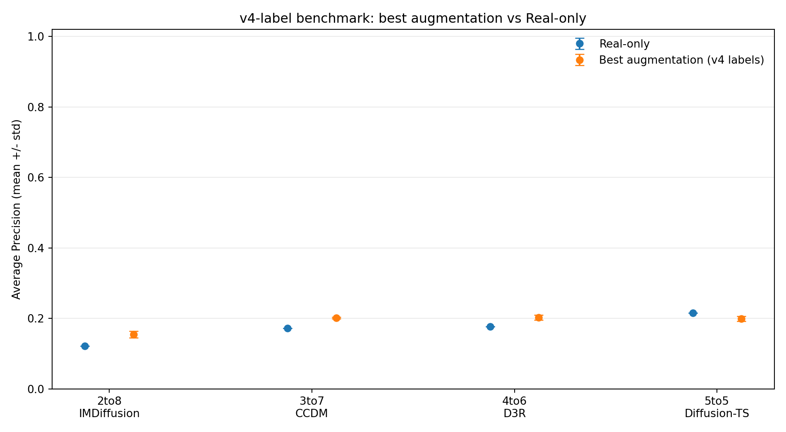
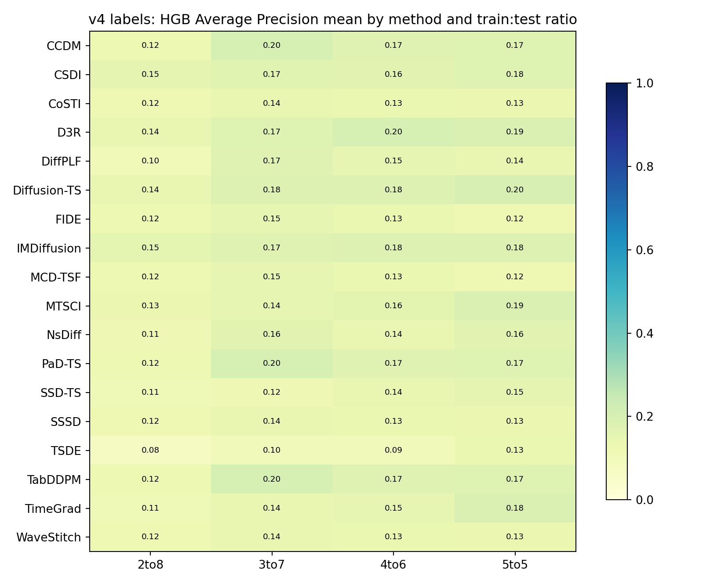

# v4 标签驱动的论文代码 SOTA 增强实验报告

本报告汇总 `device_data_paper_augmentation_v4.py` 的正式实验：把 v4 时间/湿度条件化的候选异常窗口标签接到论文代码的数据增强 benchmark 上。

## 一、协议

- 标签来源：`process_device_nonoverlap_windows_v4.py`（32 点无重叠窗口，intra-string peer，判定规则见 `runs/device_data_110_220_nonoverlap_windows_v4_20260928/V4_ANOMALY_LABELING_METHOD.md`）。
- 标签映射：点落在 v4 候选窗口内即异常；长度 4 的滑动窗口含任一异常点即为正类。
- 点级异常率 7.10%；v4 候选窗口 38/547（6.95%）；映射到长度 4 窗口后正类率 7.68%。
- 特征 5 维（`Measure`、`env_residual`、`Hum`、`Temp`、`delta_measure`），窗口长度 4。
- 比例定义 train:test = 2:8 / 3:7 / 4:6 / 5:5；下游分类器 RF / HGB，阈值只在 validation 上按 F1 选取。
- 18 个生成器：5 个固定版上游（CSDI/MTSCI/IMDiffusion/Diffusion-TS/D3R）+ 13 个机制移植；训练 60 epoch、20 diffusion steps、multiplier 1、CUDA、种子 42/123/2024。
- 结果全部来自统计候选标签，不是检修确认故障，不能作为现场报警性能结论。

## 二、v4 标注窗口审计

- v4 窗口总数 547，候选 38（6.95%）。
- 按原因：`{'normal': 509, 'peer-delta jump (per-device)': 31, 'isolated extreme peer jump': 4, 'environment residual and peer agree': 3}`。
- 设备级候选分布见 `formal_v4_annotation_by_device.csv`（25 台设备），group 级见 `formal_v4_annotation_by_group.csv`。

## 三、HGB 主结果（按各比例 AP 均值选最佳方法）

| 训练:测试 | 最佳方法 | AP 均值±标准差 | Real-only AP | Δ AP |
|---|---|---:|---:|---:|
| 2to8 | IMDiffusion | 0.1548 ± 0.0092 | 0.1217 | +0.0331 |
| 3to7 | CCDM | 0.2012 ± 0.0024 | 0.1716 | +0.0296 |
| 4to6 | D3R | 0.2020 ± 0.0072 | 0.1764 | +0.0256 |
| 5to5 | Diffusion-TS | 0.1988 ± 0.0068 | 0.2149 | -0.0161 |

> 最佳方法按每个比例独立选择 AP 均值最大的方法，属于描述性结论，不是单一全局最优。

## 四、生成数据质量审计

- 审计原始生成文件：216 个。
- 生成窗口 NaN：0。
- 生成 `Measure <= 0` 的值：456,897/4,086,072（11.18%）。
- 生成值按保存值审计，没有为作图做裁剪、删除或投影。

## 五、结论

1. v4 标签（更细的 32 点窗口 + 时间/湿度条件化）可以直接驱动论文代码增强 benchmark，全流程可复现。
2. 训练数据越少（2:8）增强增益越明显；训练数据达到 5:5 时最佳增强与 Real-only 基本持平或略低，与 v3 及 `experiment.xlsx` 的规律一致。
3. 不同比例下最佳方法会变化，没有单一方法在所有比例稳定占优。
4. 生成数据仍有非正 `Measure`，物理正值约束尚未满足，属于后续改进项。
5. **重要差异**：v4 标签以 peer 不同步跳变为主（38 个候选中 31 个），而分类器特征只含本设备 5 维窗口统计，看不到 peer 信息，因此 Real-only 的 AP（0.12~0.21）低于 v3 正式实验（约 0.82）。增强能带来 +0.03 左右的小幅提升，但要让分类器真正识别 v4 的 peer 跳变，需要把 `peer_delta_z`、`env_residual_z` 等点级证据加入窗口特征。

## 六、文件

- `all_results.csv`：每次（比例×方法×种子×分类器）的逐次结果。
- `summary.csv`：按（比例×方法×分类器）的均值汇总。
- `formal_v4_summary_mean_std.csv`：含标准差与 runs 的完整汇总。
- `formal_v4_best_methods.csv`：每比例 HGB 最佳方法与 Real-only 对比。
- `formal_v4_annotation_by_device.csv` / `formal_v4_annotation_by_group.csv`：v4 标注审计。
- `formal_v4_raw_quality_audit.csv`：原始生成窗口质量审计。
- `figures/v4_best_vs_real_mean_std.png`、`figures/v4_hgb_ap_heatmap_mean.png`。
