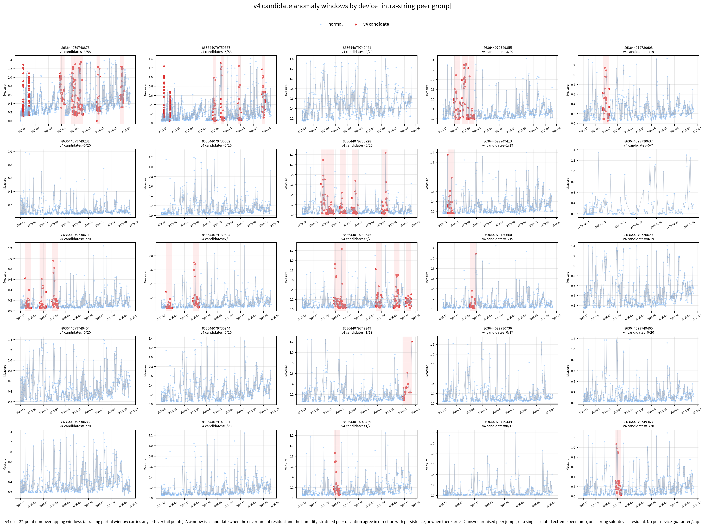
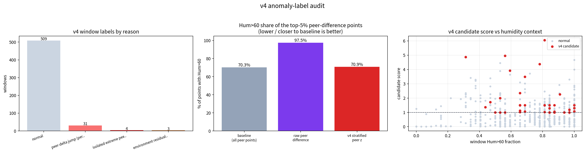
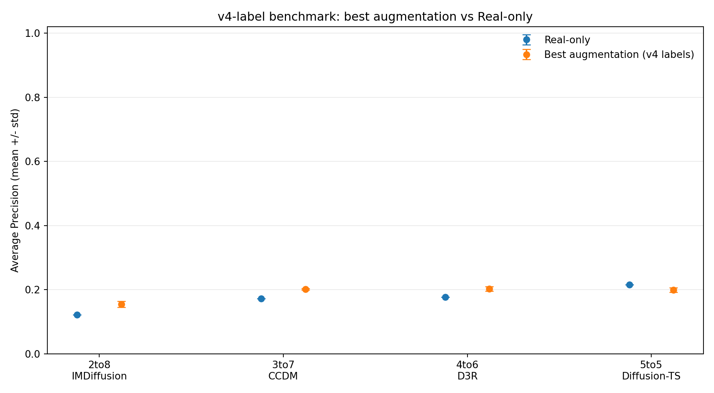
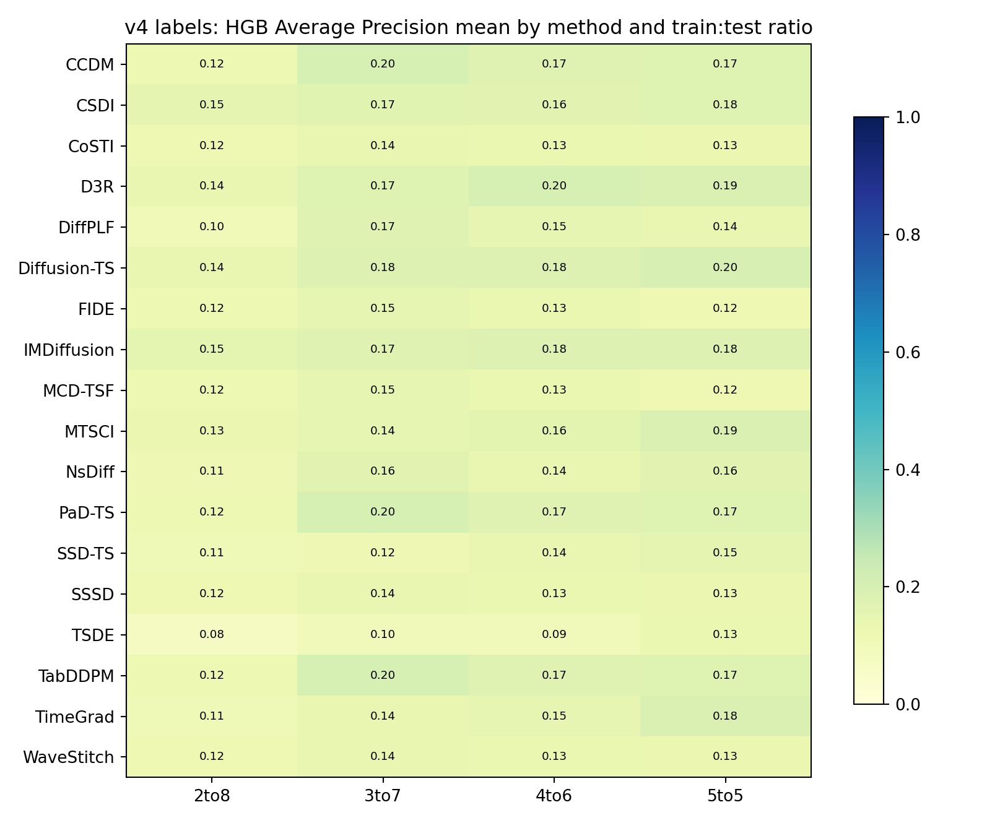
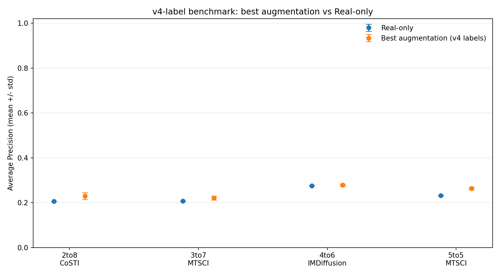
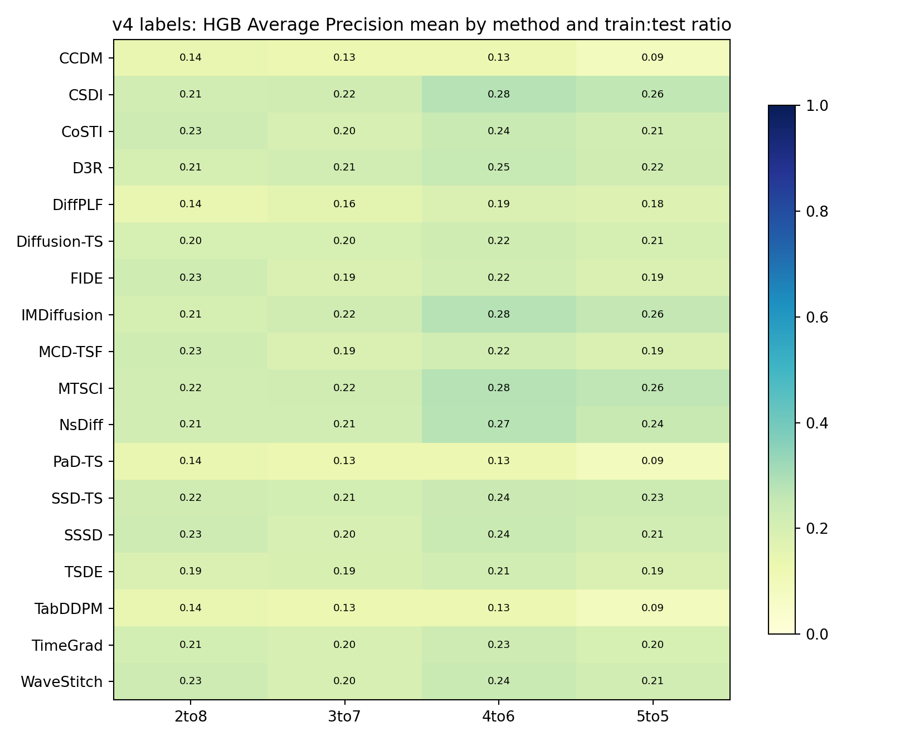

# 第一部分 · v4 异常窗口判定方法
## 1.1 为什么要条件化（v1 的两个系统性混淆）

1. **采样间隔随时间变大**：110kV 早期中位间隔约 30 分钟、后期约 12 小时（约 24 倍）；220kV 约 4 小时→12 小时（约 3 倍）。「64 个点」在早期约代表 1～2 天、后期约 32 天，窗口之间时间尺度不可比。
2. **`Measure` 与湿度强相关**：全设备 `corr(Measure, Hum)=0.497`，`Hum<=60` 时 `Measure` 均值约 0.112，`Hum>60` 时约 0.302，P95 从 0.276 升到 0.859。高湿抬升是正常物理现象；直接用「`Measure` 高」或「原始 peer 差大」判异常会大面积误标高湿——实测点级 `|peer 差|` 最大的 5% 点有 **97.5%** 落在 `Hum>60`（基准约 70%）。

v4 总原则：**先把时间和湿度条件化，只把「无法被时间、温度、湿度、peer 共同解释」的偏离判为异常。**

## 1.2 判定流程（六步）

1. **时间归一化与窗口切分**：32 点无重叠窗口；记录 `duration_hours`、`n_points`、`median_interval_hours`；斜率按真实时长归一化；末尾残余点 `>= 2` 时补一个 `tail` 部分窗口，逐点覆盖 0 丢点。
2. **设备级环境基线**：逐设备 `Measure ~ Huber(Temp, Hum, elapsed)`（eps=1.5, alpha=1e-4），得 `env_residual`。
3. **湿度分层稳健标准化**：先按设备做中位数/MAD 稳健标准化，再按湿度分箱（`[0,30,40,50,55,60,65,70,75,80,90,100,101)`）做**正态分位标准化**（rank→标准正态分位），得 `env_residual_z`。分位标准化同时去掉位置、尺度和尾部形状对湿度的依赖，是混淆审计能回到基准的关键。
4. **湿度分层 peer 比较**：默认 `intra-string`（同串多台互为 peer，9 个 group，25 台全有 peer）；最近时间匹配，容差 `0.5×局部中位间隔`（裁剪 30min~12h）；多 peer 取逐时间中位数，得 `peer_delta`，再在 `(group × 湿度箱)` 内做正态分位标准化得 `peer_delta_z`；仅当整块 peer 面板匹配时记 `peer_complete`。
5. **不同步跳变**：逐设备一阶差分 / `sqrt(2)`，再除以该设备 `peer_delta` 自身的稳健尺度，得 `peer_delta_jump_z`（用水平量尺度作分母，避免零膨胀差分把微小波动放大）。
6. **窗口判定规则**（任一成立即候选）：

| 规则 | 触发条件 | `anomaly_reason` |
|---|---|---|
| A 环境残差与 peer 同向且持续 | `residual_z_mean_z>=3` 且 `abs2_residual_fraction>=0.15` 且 `peer_z_mean_z>=3` 且同号 | `environment residual and peer agree` |
| B peer 不同步跳变（窗口级） | 窗口内 `peer_delta_jump_z>=8` 的点数 `>=2` | `peer-delta jump (per-device)` |
| C 孤立极端跳变 | 单点 `peer_delta_jump_z>=12` 单独成候选 | `isolated extreme peer jump` |
| D 无 peer 设备强残差 | `has_peer==0` 且 `abs2_residual_fraction>=0.15` 且 `residual_z_abs_q90>=2` 且大残差跳变 `>=2` | `no-peer strong residual (solo device)` |

窗口级证据在**全数据集窗口池**上做稳健 z 计分；取消「每设备保底 / 最多标一半」，改为输出 `candidate_score` / `candidate_rank` 置信度排序。

## 1.3 阈值

| 参数 | 取值 |
|---|---|
| 窗口级证据稳健 z 阈值 | 3.0 |
| 持续性（`|env_residual_z|>=2` 点占比） | 0.15 |
| 窗口级每窗口大跳数下限 | 2 |
| 点级残差跳变 z | 2.5 |
| 点级 peer 跳变 z | 8.0 |
| 点级孤立极端 peer 跳变 z | 12.0 |
| tail 窗口最小点数 | 2 |

## 1.4 标注结果（25 设备 / 547 窗口）

| 指标 | 数值 |
|---|---:|
| 窗口总数 | 547（full 524 + tail 23） |
| peer group 数（intra-string） | 9 |
| 候选异常窗口 | **38（6.95%）** |
| `peer-delta jump (per-device)` | 31 |
| `isolated extreme peer jump` | 4 |
| `environment residual and peer agree` | 3 |
| 候选窗口 `Hum>60` 占比 | 74.0%（基准 71.1%） |
| 点级 top5% `Hum>60`：原始 peer 差 → 分层 peer z | 97.5% → **70.9%**（基准 70.3%） |

结论：条件化后 peer 判据不再系统性挑高湿时段，候选不再依赖人为保底，逐点覆盖 25 台 0 丢点。标签是统计意义上的 pseudo anomaly，不是检修确认故障。





---

# 第二部分 · 论文代码 SOTA 数据增强协议

把 v4 标签接到论文代码的数据增强 benchmark（脚本 `device_data_paper_augmentation_v4.py`）。

- 标签映射：点落在 v4 候选窗口内即异常；长度 4 的滑动窗口含任一异常点即为正类。
- 点级异常率 7.10%；v4 候选窗口 38/547（6.95%）；映射到长度 4 窗口后正类率 7.68%。
- 比例定义 train:test = 2:8 / 3:7 / 4:6 / 5:5；下游分类器 RF / HGB，阈值只在 validation 上按 F1 选取。
- 18 个生成器：5 个固定版上游（CSDI/MTSCI/IMDiffusion/Diffusion-TS/D3R）+ 13 个机制移植（TimeGrad、NsDiff、FIDE、PaD-TS、WaveStitch、TabDDPM、CCDM、DiffPLF、TSDE、SSSD、CoSTI、SSD-TS、MCD-TSF）。
- 训练 60 epoch、20 diffusion steps、multiplier 1、CUDA、种子 42/123/2024；每套配置 216 次生成。
- 结果全部来自统计候选标签，不是检修确认故障，不能作为现场报警性能结论。

两套 **5 维** 窗口特征（上游扩散模型构造器固定为 5 通道，故两套必须保持 5 维）：

- **base**：`Measure, env_residual, Hum, Temp, delta_measure`
- **v4-evi**：`Measure, env_residual_z, peer_delta_z, peer_delta_jump_z, delta_measure`，`peer_delta_jump_z` 在 MinMax 前裁剪到 20（单点跳变阈值 12），无 peer 匹配处按标准分空间补 0。

---

# 第三部分 · base 特征结果

- 结果目录：`../02_benchmark_base_features/`（216 个 `raw_*.npz` + 216 个溯源 csv）

HGB，每比例最佳方法（按 AP 均值选，描述性）：

| 训练:测试 | 最佳方法 | AP 均值±标准差 | Real-only AP | Δ AP |
|---|---|---:|---:|---:|
| 2:8 | IMDiffusion | 0.1548 ± 0.0092 | 0.1217 | +0.0331 |
| 3:7 | CCDM | 0.2012 ± 0.0024 | 0.1716 | +0.0296 |
| 4:6 | D3R | 0.2020 ± 0.0072 | 0.1764 | +0.0256 |
| 5:5 | Diffusion-TS | 0.1988 ± 0.0068 | 0.2149 | −0.0161 |

生成质量：216 个文件，NaN 0，`Measure<=0` 456,897/4,086,072（11.18%）。

问题：v4 候选以 peer 跳变为主（31/38），base 特征看不到 peer 信息，Real-only AP 偏低（0.12~0.21，远低于 v3 正式实验约 0.82），5:5 增强还略低于 Real-only。





---

# 第四部分 · v4-evidence 特征结果（优化版）

把 v4 判定的点级证据（`env_residual_z`、`peer_delta_z`、`peer_delta_jump_z`）直接作为窗口通道，让分类器能看到 peer 偏离。

- 结果目录：`../03_benchmark_v4_evidence_features/`（216 个 `raw_*.npz` + 216 个溯源 csv）

HGB，每比例最佳方法：

| 训练:测试 | 最佳方法 | AP 均值±标准差 | Real-only AP | Δ AP |
|---|---|---:|---:|---:|
| 2:8 | CoSTI | 0.2298 ± 0.0154 | 0.2062 | +0.0237 |
| 3:7 | MTSCI | 0.2208 ± 0.0085 | 0.2071 | +0.0137 |
| 4:6 | IMDiffusion | 0.2786 ± 0.0052 | 0.2746 | +0.0040 |
| 5:5 | MTSCI | 0.2639 ± 0.0057 | 0.2323 | +0.0316 |

生成质量：216 个文件，NaN 0，`Measure<=0` 436,085/4,086,072（10.67%）。





---

# 第五部分 · base vs v4-evidence 对比与总结论

两次实验使用完全相同的 v4 标签、比例、方法与种子，唯一区别是 5 维窗口特征（HGB，3 种子均值）：

| 训练:测试 | base Real-only | v4-evi Real-only | Δ Real-only | base 最佳(方法,AP) | v4-evi 最佳(方法,AP) | v4-evi Δ vs 自身 Real-only |
|---|---:|---:|---:|---|---|---:|
| 2:8 | 0.1217 | 0.2062 | +0.0845 | IMDiffusion 0.1548 | CoSTI 0.2298 | +0.0237 |
| 3:7 | 0.1716 | 0.2071 | +0.0356 | CCDM 0.2012 | MTSCI 0.2208 | +0.0137 |
| 4:6 | 0.1764 | 0.2746 | +0.0982 | D3R 0.2020 | IMDiffusion 0.2786 | +0.0040 |
| 5:5 | 0.2149 | 0.2323 | +0.0174 | Diffusion-TS 0.1988 | MTSCI 0.2639 | +0.0316 |

## 总结论

1. v4 标签（32 点窗口 + 时间/湿度条件化）可以直接驱动论文代码增强 benchmark，全流程可复现。
2. 加入 v4-evidence 后 Real-only AP 全面提升（+0.02~+0.10）；**四个比例的最佳增强全部超过 Real-only**（+0.004~+0.032），并修掉了 base 版 5:5 增强略低于 Real-only 的问题——说明分类器现在能真正吃到 v4 的 peer 判据。
3. 训练数据越少（2:8）增强增益越大；训练数据达到 5:5 时增益变小，与 v3 及 `experiment.xlsx` 的规律一致。
4. 不同比例下最佳方法会变化，没有单一方法在所有比例稳定占优。

## 局限

1. v4 标签是统计候选（pseudo anomaly），不是检修确认故障，不能作为现场报警性能结论。
2. 窗口仍为固定点数；速率特征已按真实时长归一化，但「按固定时间长度切窗」尚未落地。
3. 生成值仍有非正 `Measure`（base 11.18%、v4-evi 10.67%），物理正值约束未满足。
4. 环境/湿度目前用于条件化与审计，不代表生成器真正学到了环境因果关系。

---

# 第六部分 · 文件与复现

## 目录

| 路径 | 内容 |
|---|---|
| `../01_anomaly_labeling/` | v4 方法报告、`protocol_v4.json`、逐窗口/点级 csv、两张审计图 |
| `../02_benchmark_base_features/` | base 特征 SOTA 增强全部产物 |
| `../03_benchmark_v4_evidence_features/` | v4-evidence 特征 SOTA 增强全部产物 |
| `../04_smoke/` | 小规模冒烟（base / v4evi） |
| `../05_scripts/` | 4 个复现脚本副本 |
| `../06_reports/` | 本汇总报告及四份分报告 |

## 关键文件

| 文件 | 说明 |
|---|---|
| `01_anomaly_labeling/device_nonoverlap_windows_v4.xlsx` | 逐窗口特征 + v4 标签（`window_features`/`summary`） |
| `01_anomaly_labeling/device_points_v4.csv` | 点级证据（`env_residual_z`、`peer_delta_z`、`peer_delta_jump_z`） |
| `02_*/all_results.csv` | base 特征逐次结果（比例×方法×种子×分类器） |
| `03_*/all_results.csv` | v4-evidence 特征逐次结果 |
| `03_*/formal_v4_best_methods.csv` | v4-evidence 每比例最佳方法与 Real-only 对比 |
| `*/formal_v4_summary_mean_std.csv` | 各特征均值±标准差完整汇总 |
| `*/raw_<ratio>_<method>_seed<seed>.npz` | 各方法生成窗口（含 `source_*` 溯源） |

## 复现命令

```bash
PY=/home/test/miniconda3/envs/jyz_paper/bin/python
# 1) v4 标注
$PY process_device_nonoverlap_windows_v4.py \
    --output runs/device_data_110_220_nonoverlap_windows_v4_20260928 \
    --window-size 32 --peer-group-mode intra-string
# 2) base 特征 SOTA 增强
$PY device_data_paper_augmentation_v4.py --output runs/device_data_110_220_paper_aug_v4_20260930 \
    --feature-set base --epochs 60 --steps 20 --seeds 42,123,2024
# 3) v4-evidence 特征 SOTA 增强
$PY device_data_paper_augmentation_v4.py --output runs/device_data_110_220_paper_aug_v4evi_20261009 \
    --feature-set v4-evi --epochs 60 --steps 20 --seeds 42,123,2024
# 4) 汇总与对比
$PY summarize_formal_results_v4.py --run runs/device_data_110_220_paper_aug_v4evi_20261009
$PY compare_v4_feature_runs.py --base runs/device_data_110_220_paper_aug_v4_20260930 \
    --v4evi runs/device_data_110_220_paper_aug_v4evi_20261009 \
    --output runs/device_data_110_220_paper_aug_v4evi_20261009/COMPARE_V4FEATURE.md
```

脚本间存在相对导入，请在 `code_reproduction/experiment_augmentation/` 目录内运行；`05_scripts/` 内为本套 v4 脚本副本。
